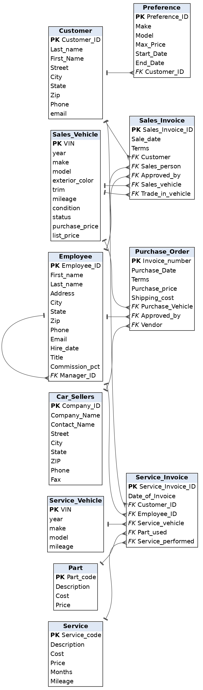

# SLO Vintage Auto: Relational Database for a Classic-Car Dealership

**Oracle SQL · Data modeling · Constraints · Views · Joins and aggregation**
Cal Poly BUS 393 *Database Systems in Business* (Spring 2023), Team 10 project.

## The business problem
SLO Vintage Auto is a small San Luis Obispo dealership that buys, sells and services classic cars. It needed one database to track:
- employees and who reports to whom (with sales commission rules),
- customers and the cars they're looking for,
- inventory bought from outside sellers, including trade-ins,
- sales, purchase orders and service work, with parts and labor.

## Data model (11 tables)
| Table | What it holds | Key relationships |
|---|---|---|
| `Employee` | Staff, title, commission | `Manager_ID` → `Employee` (self-join org chart) |
| `Customer` | Buyers and service customers | |
| `Preference` | Car a customer wants and max price | → `Customer` |
| `Sales_Vehicle` | Inventory: status `FORSALE` / `SOLD` / `TRADEIN`, purchase and list price | |
| `Service_Vehicle` | Customer cars brought in for service | |
| `Service` / `Part` | Service catalog and parts catalog (cost and price) | |
| `Car_Sellers` | Vendors the dealership buys from | |
| `Purchase_Order` | Buying a car from a vendor | → `Sales_Vehicle`, `Car_Sellers`, `Employee` (approver) |
| `Sales_Invoice` | Selling a car, optional trade-in | → `Customer`, `Employee` (salesperson, approver), `Sales_Vehicle` ×2 |
| `Service_Invoice` | A service visit | → `Customer`, `Employee`, `Service_Vehicle`, `Part`, `Service` |



**Business rules enforced in the schema**
- Salespeople must have a 20–30% commission; everyone else has none (`CHECK`).
- A preference's end date must be after its start date.
- A service invoice must list a part, a service, or both.
- Prices and mileage can't be negative; vehicle status is limited to three values.

## How to run
Works in any Oracle database (free options: Oracle APEX workspace, Oracle Live SQL, or Oracle Database Free in Docker).
1. `schema.sql`: drops and recreates all 11 tables in dependency order.
2. `seed_data.sql`: loads sample employees, customers and vehicles, plus 8 purchase orders, 5 sales and 7 service invoices.
3. `views.sql`: creates the views: reference lists (contacts, org chart, services, parts, vendors) and customer reports (buyers, customers by city, buyers with no service history, open Porsche interest, no-trade buyers, cars per customer).
4. `sample_queries.sql`: example business questions.

## Sample questions the database answers
- What's in stock right now, priced highest to lowest?
- What was the estimated gross profit on each car sold, based on list price?
- Which salesperson sold the most?
- Which vendors do we spend the most with?
- Which customers have an open preference that matches a car we have in stock?

```sql
-- Estimated gross profit on every car sold (no final sale price is stored)
SELECT VIN, year || ' ' || make || ' ' || model AS vehicle,
       list_price - purchase_price AS gross_profit
FROM sales_vehicle
WHERE status = 'SOLD'
ORDER BY gross_profit DESC;
```

## Team
Team project (team of 3). Built by Sean Wood and two classmates.

## Repo contents
| File | Purpose |
|---|---|
| `schema.sql`, `seed_data.sql`, `views.sql` | Cleaned, runnable build scripts |
| `sample_queries.sql` | Example queries |
| `original_export/` | The 5 decoded scripts from the team's original Oracle APEX export (sample email domains changed to example.com) |
